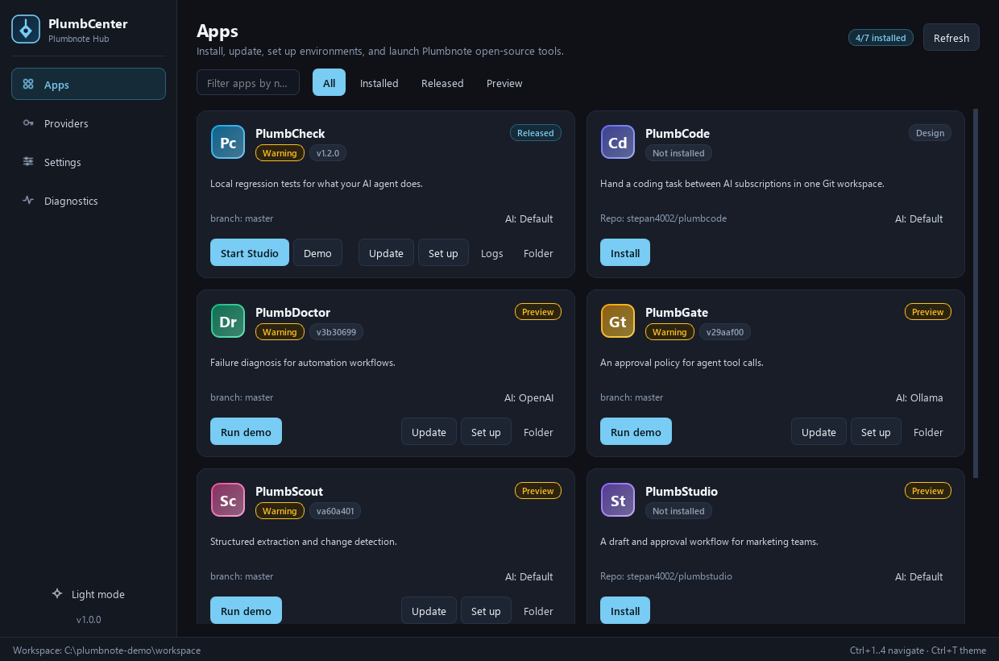

# PlumbCenter



Desktop hub for the Plumbnote open-source apps. Discover, install, update, set up, and run
PlumbCheck, PlumbCode, PlumbDoctor, PlumbGate, PlumbScout, PlumbStudio, and PlumbBridge from
one window.

Version 1.0.0. Python 3.9+. The hub UI is PySide6. Provider API keys go in the OS keyring
(`keyring`, with a per-user DPAPI file fallback on Windows). Keys are never written to
`providers.json`, logs, or the screen.

## Install

```sh
pip install -e ".[dev]"
plumbcenter gui
```

`plumbcenter-gui` is the windowed entry point. Apps are sibling folders of this repo
(`../plumbcheck`, `../plumbdoctor`, ...). Point at another folder with `--root DIR` or
`PLUMBCENTER_HOME`. Provider settings live in `~/.plumbnote/providers.json` (`PLUMBNOTE_HOME`).

## Commands

| Command | What it does |
|---|---|
| `plumbcenter gui` | Open the desktop hub |
| `plumbcenter list [--json] [--remote]` | Catalog and install status |
| `plumbcenter info <app>` | One app |
| `plumbcenter install <app>` / `update <app>` / `update --all` | Clone or fast-forward |
| `plumbcenter run <app> [demo]` | Run a short action |
| `plumbcenter start` / `stop` / `ps` / `logs` / `open` | Long-running actions |
| `plumbcenter providers list [--json]` | Providers. Keys are never printed |
| `plumbcenter providers set-default <app> <provider\|none>` | Per-app default provider |

Exit codes: `0` ok, `1` the command failed, `2` usage error or unknown app.

## Providers

OpenAI, Anthropic, Google Gemini, OpenRouter, Groq, Z.ai, Ollama, and Kilo. Ollama is local
(`http://127.0.0.1:11434`) and does not need a key. Cloud base URLs must be HTTPS. Connection
tests are cheap GETs to each provider's documented endpoint. Z.ai's docs publish chat
completions, not a models list. Kilo's documented `GET /models` does not require a key. Those
two limits are noted on the probe result.

## Works with

| App | Found and launched by the hub | Reads `~/.plumbnote/providers.json` |
|---|---|---|
| PlumbCheck, PlumbBridge | yes | not applicable (no AI calls) |
| PlumbDoctor | yes (`demo`) | yes: default provider and key from keyring service `plumbnote` |
| PlumbStudio | yes (`demo`) | yes |
| PlumbGate | yes (`demo`) | metadata only, never keys |
| PlumbCode | yes (catalog, no launch yet) | yes (`plumbcode wizard`) |
| PlumbScout | yes (`demo`) | not yet |

See [docs/PROVIDERS-CONTRACT.md](docs/PROVIDERS-CONTRACT.md) for the file format.

## Screenshots

Regenerate with `QT_QPA_PLATFORM=offscreen python scripts/capture_screenshots.py`. The script
uses a throwaway demo workspace, so no user name or local path appears in the images.

## Build

`packaging/build.ps1` makes a one-folder windowed app in `dist/PlumbCenter/`, zips it, and prints the
SHA256. It then launches the exe once with `--smoke-test` and checks the version metadata.

## Tests

```sh
python -m pytest
```

Set `QT_QPA_PLATFORM=offscreen` for GUI tests. No network and no real API keys. Tests use the
sentinel `sk-test-SENTINEL`.

## Safety

- Only registry URLs are cloned, and nothing runs through a shell.
- `update` refuses a dirty checkout and only fast-forwards.
- `setup_venv` creates `<app>/.venv` and, when `requirements.txt` exists, runs `pip install -r` on that file. It does not run other scripts.
- The legacy web hub binds to `127.0.0.1` only.

Built by [Plumbnote](https://plumbnote.com).
